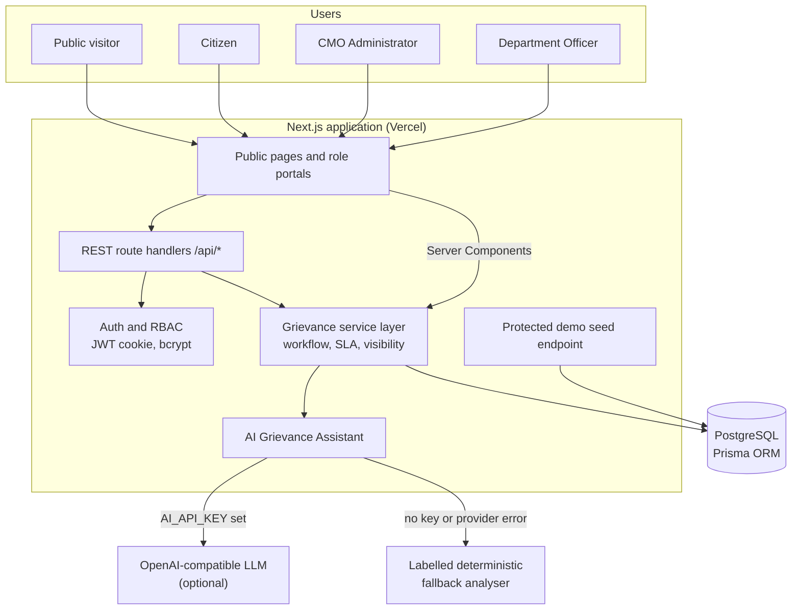
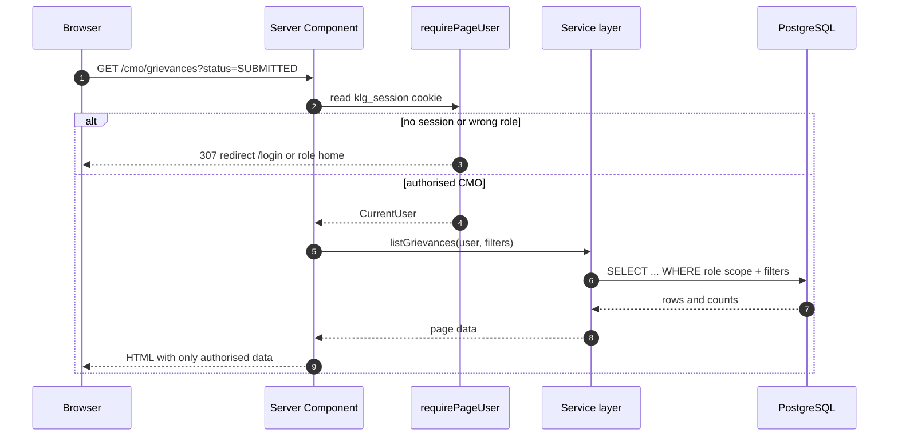
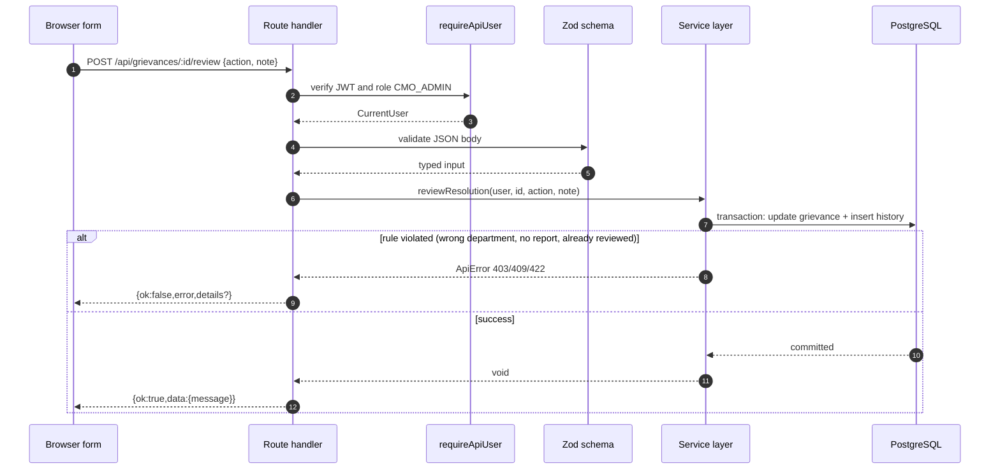
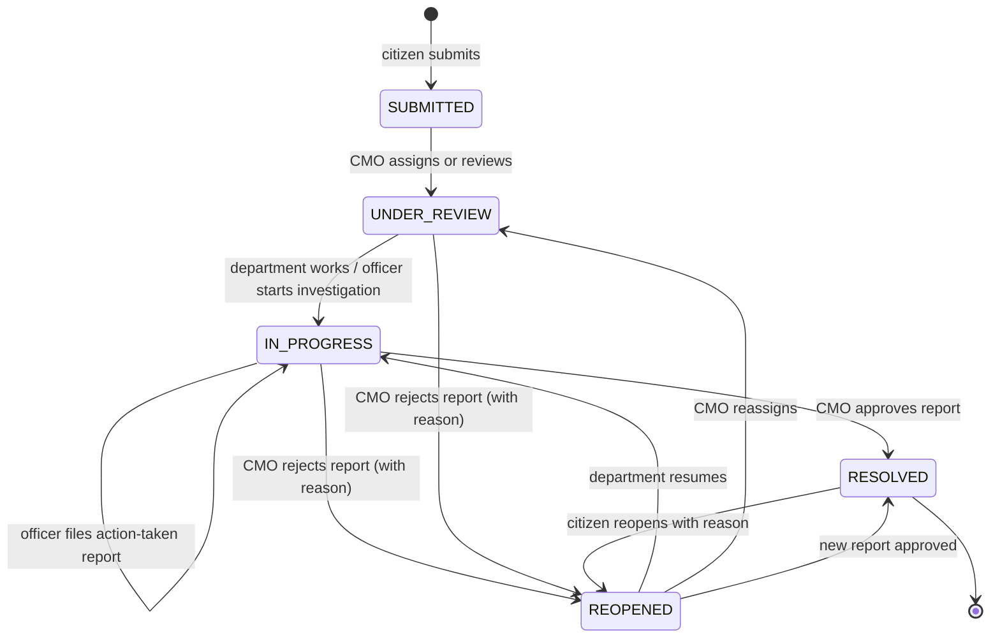
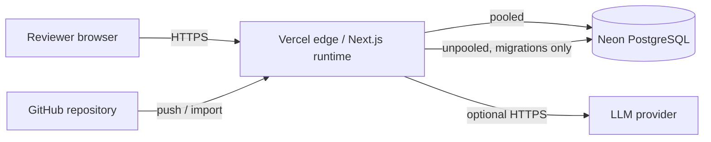

# 02 — System Architecture

## 1. Overview

The application is a single Next.js 15 App Router deployment. Server Components render the public site and role portals; small Client Components handle interactive forms and charts. REST route handlers under `src/app/api` expose the backend. All business rules live in a service layer (`src/lib/grievance-service.ts`) that both pages and APIs call, so workflow integrity does not depend on the UI.

PostgreSQL is the single source of truth for users, grievances, history, assignments, attachments (as `bytea`), feedback and contact enquiries. An optional OpenAI-compatible LLM provides advisory triage; a deterministic, clearly labelled fallback keeps the feature usable when no key is configured or the provider is unavailable.

## 2. Context diagram

## 3. Logical layers

| Layer | Files | Responsibilities |
| --- | --- | --- |
| Presentation | `src/app/(site)`, `src/app/(auth)`, `src/app/citizen`, `src/app/cmo`, `src/app/officer`, `src/components` | Server-rendered pages, accessible forms, tables, charts, role-specific navigation |
| API | `src/app/api/**/route.ts` | HTTP validation, status codes, rate limits, response envelope |
| Domain/service | `src/lib/grievance-service.ts`, `src/lib/ai.ts`, `src/lib/seed.ts` | Workflow rules, visibility filtering, SLA and stats, assignment, AI orchestration, demo data |
| Security | `src/lib/auth.ts`, `src/lib/api.ts`, `src/lib/rate-limit.ts`, `next.config.ts` | Session JWT, bcrypt, role guards, centralized errors, security headers |
| Data | `prisma/schema.prisma`, `prisma/migrations/*`, `src/lib/db.ts` | Schema, migration, Prisma client singleton |
| Shared | `src/lib/constants.ts`, `src/lib/validation.ts`, `src/lib/utils.ts` | Departments/categories/status metadata, Zod schemas, formatting/reference helpers |

## 4. Request lifecycle

### 4.1 Server-rendered page

### 4.2 Mutating API request

### 4.3 Public tracking

`GET /api/track/:reference` requires no session but is rate limited to 60 lookups per IP per 15 minutes. The service selects a public projection only: no citizen identity, email, mobile, internal history, AI prompt data or attachment metadata. Internal remarks are filtered at the query level. Description text is truncated to 600 characters.

## 5. Authentication and authorisation

- **Passwords** are hashed with bcrypt (cost 10). The login route compares against a dummy hash for unknown emails to reduce timing differences.
- **Sessions** are stateless HS256 JWTs signed with `AUTH_SECRET`, stored in the httpOnly `klg_session` cookie for 7 days (`secure` in production, `sameSite=lax`). The token contains the user id, role, name and email; the role is re-checked against the database on every `getCurrentUser` call, and deactivated users are rejected.
- **Page guards** (`requirePageUser`) redirect unauthenticated users to `/login` and send a signed-in user to their role home when they attempt another workspace.
- **API guards** (`requireApiUser`) return 401/403 rather than redirecting.
- **Object-level checks** happen in the service layer:
  - Citizen: only own grievances and attachments.
  - Officer: only grievances whose `departmentId` equals the officer's department.
  - CMO: all grievances.
- Internal remarks and internal history entries are removed from citizen and public responses.

### Role capability matrix

| Capability | Citizen | Officer | CMO |
| --- | --- | --- | --- |
| Register / login / logout | Yes | Yes (seeded accounts) | Yes (seeded account) |
| Submit grievance | Yes | No | No |
| View own / department / all grievances | Own | Department | All |
| Read internal notes | No | Yes | Yes |
| Assign or forward | No | No | Yes |
| Escalate | No | No | Yes |
| Change status | No | In Progress only | Yes (reviewed flows) |
| Submit action-taken report | No | Yes | No |
| Approve/reject resolution | No | No | Yes |
| Feedback / reopen | Own resolved cases | No | No |
| Contact enquiries | Create | No | Read |
| CMO statistics | No | Department summary | Yes |
| AI analysis | Yes | No | Yes |

## 6. Workflow state machine

Rules enforced in code:

- Officers may only set **In Progress**. Resolution requires an officer's action-taken report **and** CMO approval.
- An action-taken report can exist only once until reviewed.
- Approval is idempotent-protected: an already approved resolution cannot be reviewed again.
- Assignment is blocked for resolved cases; resolved cases cannot be escalated.
- Feedback requires a resolved case, ownership, and one submission only.
- Citizen reopen requires a resolved case, ownership, and a reason of at least 10 characters.
- All updates run inside Prisma transactions together with their history row.

## 7. SLA and prioritisation

| Priority | SLA | Typical interpretation |
| --- | --- | --- |
| HIGH | 3 days | Immediate risk to life, health or safety; hazardous infrastructure; outbreak |
| MEDIUM | 7 days | Genuine service disruption without immediate danger |
| LOW | 14 days | Suggestions, information requests, minor inconvenience |

`dueAt` is set when the grievance is created and can be overridden during assignment. `isOverdue` is a derived value (`dueAt < now` and status not Resolved); it is not stored, which avoids stale denormalised state. The CMO command centre also computes an eight-week created/resolved trend and average resolution days from stored timestamps.

## 8. File upload and retrieval

1. The citizen form posts `multipart/form-data` with fields plus an optional `attachment`; AI metadata travels as a JSON string in the `ai` field.
2. The server validates size (≤ 4 MB) and MIME type (PNG, JPEG, WebP, PDF), then stores metadata and bytes in `Attachment`.
3. Downloads go through `GET /api/attachments/:id`, which re-checks role and ownership, sets `X-Content-Type-Options: nosniff`, a safe filename, `Cache-Control: private, no-store`, and inline/attachment disposition.
4. Storing bytes in PostgreSQL keeps the demo portable on serverless hosting; it is not intended for large media libraries.

## 9. AI integration architecture

`analyzeGrievance()` is the single entry point:

1. Deterministic duplicate detection compares token sets against up to 80 recent non-resolved grievances (Jaccard + overlap, threshold 0.45, top 3).
2. If `AI_API_KEY` exists, it calls `${AI_BASE_URL}/chat/completions` with `response_format: json_object`, validates the returned department/category/priority/summary/confidence, and labels the source `llm`.
3. If the key is missing, the call fails, times out or returns invalid data, a deterministic analyser produces a suggestion and labels it `fallback` with the provider label `Labelled fallback (no AI key configured)` or `Labelled fallback (AI service unavailable)`.
4. Every response includes an advisory notice. The citizen must explicitly adopt suggestions; nothing is auto-applied, and no AI output can change status or assignment.

More detail: [05_AI_Integration.md](05_AI_Integration.md).

## 10. Error handling and response contract

- All JSON success responses use `{ ok: true, data: ... }`.
- All JSON failures use `{ ok: false, error: string, details?: unknown }`.
- Zod failures return HTTP 422 with `details` as `[{ field, message }]`; clients map these to inline field errors.
- `ApiError` carries intentional status codes (400/401/403/404/409/422/429).
- Unexpected errors are logged server-side and returned as a generic 500 without leaking internals.
- The health endpoint reports database connectivity and whether an AI key is configured.

## 11. Security posture

| Control | Implementation |
| --- | --- |
| Password storage | bcrypt cost 10 |
| Session integrity | HS256 JWT, 32+ character secret, issuer check, 7-day expiry |
| Cookie hardening | httpOnly, sameSite=lax, secure in production |
| CSRF exposure | Same-site cookie plus JSON/multipart routes; no cross-site form posts |
| Authorisation | Role + object-level checks in services, not only UI |
| Input validation | Zod on all writes, enum restrictions for district/category/priority/status |
| Upload safety | MIME allowlist, size limit, sanitised filename, `nosniff` |
| Abuse control | Login, registration, contact, tracking, submission and AI rate limits |
| Headers | CSP, frame deny, referrer policy, permissions policy |
| Secret handling | `.env` ignored; `.env.example` contains placeholders only |
| Audit | Append-only history with actor id/name/role and timestamp |

## 12. Deployment topology

- `vercel-build` runs `prisma generate && prisma migrate deploy && next build`.
- `DATABASE_URL` uses the Neon pooled string; `DIRECT_URL` uses the unpooled string for migrations.
- The protected seed endpoint runs once after the first deployment.
- Attachments and sessions do not depend on the local filesystem, so the app works on serverless infrastructure.

## 13. Key decisions and trade-offs

| Decision | Why | Trade-off |
| --- | --- | --- |
| Next.js full-stack instead of separate Express server | One deployable unit, server components reduce client JavaScript, route handlers still satisfy the REST requirement | Tied to the Next.js runtime |
| Service layer shared by pages and APIs | One implementation of workflow and visibility rules | Slightly more indirection than querying Prisma in pages |
| Postgres `bytea` attachments | Works on serverless, atomic with grievance creation | Not scalable for large files; no CDN or virus scanning |
| Stateless JWT sessions | No session table or sticky sessions | Revocation requires rotating the secret or adding a token version |
| Advisory AI with labelled fallback | Demo remains functional without a key and is honest about its source | Fallback quality is keyword-driven, not semantic |
| In-memory rate limiting | Zero infrastructure for a prototype | Not shared across serverless instances |
| Seeded demo data through a protected endpoint | Reviewers can reproduce data without local scripts | Requires `SEED_TOKEN` and env access |

## 14. Observability and operations

- `/api/health` returns service name, database reachability, AI-key presence and time; use it for uptime checks.
- Server-side errors are logged with an `[api]` prefix. The AI fallback logs the provider error reason without exposing secrets.
- The CMO dashboard is the operational view: overdue, awaiting-review and escalated counts are visible at a glance.
- There is no external APM, structured logging pipeline or alerting in this prototype.

## 15. Scalability notes

For a production system, the next steps would be: move rate limiting to Redis, move attachments to object storage with signed URLs, add background jobs for notifications, introduce an audit/event store, add database read replicas and PITR, and put the LLM behind a queue with retries and cost controls.
