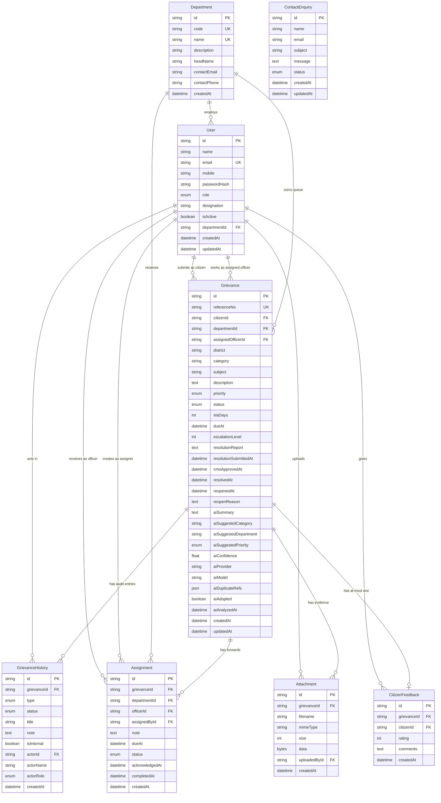

# 03 — Database Design

## 1. Overview

The persistence layer is **PostgreSQL** accessed through **Prisma ORM 6.19**. The schema is defined in [`prisma/schema.prisma`](../prisma/schema.prisma) and applied with the committed migration [`prisma/migrations/20261111000000_init/migration.sql`](../prisma/migrations/20261111000000_init/migration.sql).

Design principles:

1. **One grievance, one authoritative status.** Status lives on `Grievance`; history is an append-only audit trail, not a second source of truth.
2. **Every action is attributable.** History, assignments and feedback record who did what and when. History snapshots the actor's name and role even if the user record later changes.
3. **Internal and public views share tables, differ by projection.** `GrievanceHistory.isInternal` controls visibility; services filter it before returning citizen/public data.
4. **Referential integrity over deletion.** Grievances cascade-delete their history, assignments, attachments and feedback, but user and department records are protected because grievances reference them.
5. **Derived values are computed, not duplicated.** `isOverdue` is calculated from `dueAt` and status; only SLA inputs (`slaDays`, `dueAt`) are stored.

## 2. Entity-relationship diagram



Standalone source: [`diagrams/database-er.mmd`](diagrams/database-er.mmd).

## 3. Enumerations

| Enum | Values | Used by |
| --- | --- | --- |
| `Role` | `CITIZEN`, `CMO_ADMIN`, `OFFICER` | `User.role`, `GrievanceHistory.actorRole` |
| `Priority` | `LOW`, `MEDIUM`, `HIGH` | `Grievance.priority`, `Grievance.aiSuggestedPriority` |
| `GrievanceStatus` | `SUBMITTED`, `UNDER_REVIEW`, `IN_PROGRESS`, `RESOLVED`, `REOPENED` | `Grievance.status`, history snapshots |
| `HistoryType` | `CREATED`, `STATUS_CHANGE`, `ASSIGNMENT`, `REMARK`, `ESCALATION`, `RESOLUTION`, `AI_ANALYSIS`, `FEEDBACK`, `REOPEN` | `GrievanceHistory.type` |
| `AssignmentStatus` | `ASSIGNED`, `ACKNOWLEDGED`, `COMPLETED` | `Assignment.status` |
| `EnquiryStatus` | `NEW`, `READ`, `RESPONDED` | `ContactEnquiry.status` |

The five `GrievanceStatus` values are the exact statuses required by the machine test; no extra statuses exist.

## 4. Table details

### 4.1 `User`

Stores all three roles in one table. Citizens have no department; officers have exactly one department; the CMO administrator has none.

| Column | Type | Notes |
| --- | --- | --- |
| `id` | `text` PK | `cuid()` in application-created records; deterministic demo IDs in the seed |
| `name` | `text` | Display name, 2–80 characters validated at the API |
| `email` | `text` unique | Lowercased and normalised by Zod |
| `mobile` | `text?` | 10-digit Indian mobile for citizens |
| `passwordHash` | `text` | bcrypt hash (cost 10); never returned by APIs |
| `role` | `Role` | Default `CITIZEN`; only the seed creates privileged roles |
| `designation` | `text?` | Officer/CMO job title shown in the UI |
| `isActive` | `boolean` | Deactivated users cannot authenticate |
| `departmentId` | `text?` FK → `Department.id` | Officer queue scoping; `SET NULL`-like protection because departments are seeded, not deleted |
| `createdAt`, `updatedAt` | `timestamp` | UTC |

Indexes: `role`, `departmentId`, unique `email`.

### 4.2 `Department`

| Column | Type | Notes |
| --- | --- | --- |
| `id` | `text` PK | |
| `code` | `text` unique | `PWD`, `HEALTH`, `EDU`, `KWA`, `KSEB`, `REV`, `LSGD`, `TRANS`, `AGRI`, `SWD`, `HOME` |
| `name` | `text` unique | Official-style demonstration name |
| `description` | `text` | Shown on the public department directory |
| `headName`, `contactEmail`, `contactPhone` | `text?` | Fictional demonstration contacts |

This table drives the public directory, assignment picker and officer/department statistics. Department codes are also the AI's allowed routing targets.

### 4.3 `Grievance`

The central table.

| Column group | Columns | Notes |
| --- | --- | --- |
| Identity | `id`, `referenceNo` | `referenceNo` is unique and human-readable (`KLG-YYYY-XXXXXX`) |
| Ownership | `citizenId`, `departmentId`, `assignedOfficerId` | Citizen required; department/officer optional until assignment |
| Classification | `district`, `category`, `subject`, `description`, `priority`, `status` | District and category are constrained by Zod enums; priority defaults to Medium; status to Submitted |
| SLA | `slaDays`, `dueAt`, `escalationLevel` | `dueAt` set from `SLA_DAYS[priority]`; escalation increments the level and raises priority |
| Resolution | `resolutionReport`, `resolutionSubmittedAt`, `cmoApprovedAt`, `resolvedAt`, `reopenedAt`, `reopenReason` | Report does not change status; approval sets Resolved; rejection or citizen reopen sets Reopened |
| AI metadata | `aiSummary`, `aiSuggestedCategory`, `aiSuggestedDepartment`, `aiSuggestedPriority`, `aiConfidence`, `aiProvider`, `aiModel`, `aiDuplicateRefs`, `aiAdopted`, `aiAnalyzedAt` | Advisory record for audit; `aiDuplicateRefs` is JSON |
| Timestamps | `createdAt`, `updatedAt` | UTC |

Indexes: `status`, `priority`, `district`, `category`, `departmentId`, `citizenId`, `createdAt`. These support the list filters, role scoping and dashboard aggregations.

Deletion behaviour: deleting a grievance cascades to its history, assignments, attachments and feedback. There is no citizen-facing delete operation in this prototype.

### 4.4 `GrievanceHistory`

Append-only audit trail. One row per event.

| Column | Type | Notes |
| --- | --- | --- |
| `type` | `HistoryType` | Created, status change, assignment, remark, escalation, resolution, AI analysis, feedback, reopen |
| `status` | `GrievanceStatus?` | Snapshot of the resulting status, when relevant |
| `title` | `text` | Short human-readable event title |
| `note` | `text?` | Detail or reason |
| `isInternal` | `boolean` | Hidden from citizens and public tracking when true |
| `actorId` | `text?` FK → `User.id` | Null for the AI assistant event |
| `actorName`, `actorRole` | `text`, `Role` | Snapshots so the trail remains readable if accounts change |
| `createdAt` | `timestamp` | Event time |

Composite index: `(grievanceId, createdAt)` for chronological timelines.

Visibility rules:

- Citizen detail: `isInternal = false` only.
- Public tracking: `isInternal = false` only, selected directly in the query.
- CMO and the owning department officer: all entries.

### 4.5 `Assignment`

Records every forward/assignment attempt and its lifecycle.

| Column | Notes |
| --- | --- |
| `grievanceId`, `departmentId`, `officerId?` | Target desk; officer must belong to that department |
| `assignedById` | CMO administrator who made the assignment |
| `note`, `dueAt` | Optional instruction and SLA override |
| `status` | `ASSIGNED` → `ACKNOWLEDGED` when an officer submits a report → `COMPLETED` when the CMO approves |
| `acknowledgedAt`, `completedAt` | Timestamps for the lifecycle |
| `createdAt` | Assignment time |

The grievance also stores the current `departmentId` and `assignedOfficerId` for fast filtering; `Assignment` preserves the history of previous forwards.

### 4.6 `Attachment`

| Column | Notes |
| --- | --- |
| `filename` | Sanitised for the `Content-Disposition` header on download |
| `mimeType` | One of `image/png`, `image/jpeg`, `image/webp`, `application/pdf` |
| `size` | Bytes, maximum 4 MB validated server-side |
| `data` | PostgreSQL `bytea` |
| `uploadedById` | Citizen who uploaded it (seed attachments also use the citizen) |

Access is never public: the route checks that the requester is the owner citizen, an officer in the relevant department, or a CMO administrator.

### 4.7 `CitizenFeedback`

| Column | Notes |
| --- | --- |
| `grievanceId` unique | At most one feedback per grievance |
| `citizenId` | Must match the grievance owner |
| `rating` | Integer 1–5, coerced and validated by Zod |
| `comments` | Optional, up to 1000 characters |
| `createdAt` | Submission time |

Feedback is accepted only after the grievance reaches Resolved. It is surfaced on the CMO dashboard as count and average rating.

### 4.8 `ContactEnquiry`

Public contact form submissions. Status defaults to `NEW`; the CMO enquiries page can display `READ`/`RESPONDED` seed records. There is no outbound email integration.

Index: `createdAt` for the newest-first inbox.

## 5. Relationship summary

| Parent | Child | Cardinality | On delete |
| --- | --- | --- | --- |
| `Department` | `User` | 1 → many | Restricted by FK (departments are not deleted) |
| `Department` | `Grievance` | 1 → many | Grievance holds the FK; null when unassigned |
| `Department` | `Assignment` | 1 → many | Restricted |
| `User` (citizen) | `Grievance` | 1 → many | Restricted; grievances preserve the citizen link |
| `User` (officer) | `Grievance` | 1 → many | Assigned officer may be null |
| `Grievance` | `GrievanceHistory` | 1 → many | Cascade |
| `Grievance` | `Assignment` | 1 → many | Cascade |
| `Grievance` | `Attachment` | 1 → many | Cascade |
| `Grievance` | `CitizenFeedback` | 1 → 0..1 | Cascade |
| `User` | `CitizenFeedback` | 1 → many | Restricted |

## 6. Audit and traceability

A typical lifecycle produces history rows in this order:

1. `CREATED` — "Grievance submitted", actor = citizen.
2. `AI_ANALYSIS` — advisory suggestion recorded, actor = "AI Grievance Assistant" (`actorId` null). It is marked non-internal so the suggestion is transparent in the citizen timeline; it never changes the grievance state.
3. `ASSIGNMENT` — "Forwarded to Kerala Water Authority", actor = CMO, optionally naming the officer.
4. `STATUS_CHANGE` — "Status changed to in progress", actor = officer.
5. `REMARK` — department or CMO note; internal or citizen-visible.
6. `ESCALATION` — internal note with reason and priority change.
7. `RESOLUTION` — action-taken report text, actor = officer.
8. `STATUS_CHANGE` — "Resolution confirmed by CMO", actor = CMO.
9. `FEEDBACK` — internal note with rating and comments, actor = citizen.
10. `REOPEN` — reason, actor = citizen or CMO.

No code path updates or deletes an existing history row.

## 7. Data integrity rules

- Enums at the database level prevent invalid statuses, priorities, roles or event types.
- Unique constraints prevent duplicate emails, department codes/names and feedback per grievance.
- The reference number is generated from an unambiguous alphabet (no `0`, `O`, `I`), checked for uniqueness, and retried up to five times on a collision.
- Transactions wrap grievance creation, assignment, status changes, resolution submission/review, feedback and reopen together with their history rows.
- `CitizenFeedback.grievanceId` is unique, enforcing one feedback submission regardless of UI state.
- Timestamps are stored in UTC and formatted for `Asia/Kolkata` in the UI.

## 8. Seed data profile

| Entity | Rows | Notes |
| --- | --- | --- |
| Departments | 11 | All codes used by AI routing and officer accounts |
| Users | 16 | 1 CMO, 11 officers, 4 citizens |
| Grievances | 17 | Spread across all five statuses, all 14 districts, all priorities |
| History entries | Many per grievance | Created, AI, assignment, remarks, escalation, resolution, feedback, reopen as applicable |
| Assignments | For assigned cases | Mixed `ASSIGNED`, `ACKNOWLEDGED`, `COMPLETED` |
| Attachments | Selected cases | Generated PDF bytes, fictional content |
| Citizen feedback | On resolved cases | Ratings and comments |
| Contact enquiries | 3 | NEW, READ and RESPONDED examples |

The seed skips when the `Grievance` table is non-empty, preventing duplicate demo data on redeploys.

## 9. Migration and schema workflow

```bash
# Apply committed migrations (production and fresh local DBs)
npx prisma migrate deploy

# Create a new migration during development
npx prisma migrate dev --name <change-name>

# Regenerate the typed client after schema changes
npx prisma generate

# Inspect data
npx prisma studio
```

The `postinstall` script runs `prisma generate`, and `vercel-build` runs generate + migrate deploy + build, so a fresh Vercel deployment creates all tables automatically.

## 10. Capacity and production considerations

- `bytea` attachments are acceptable for a small prototype but should move to object storage for scale.
- Dashboard aggregates use `groupBy` and targeted counts; at very large volumes these should be pre-aggregated or cached.
- Text search uses `ILIKE` (`contains` with case-insensitive mode); PostgreSQL full-text search would be the next step.
- The history table grows with every action; production would partition or archive old entries and possibly add an immutable event log.
- Backups, PITR and connection pooling are delegated to the managed Postgres provider (Neon in the recommended deployment).
