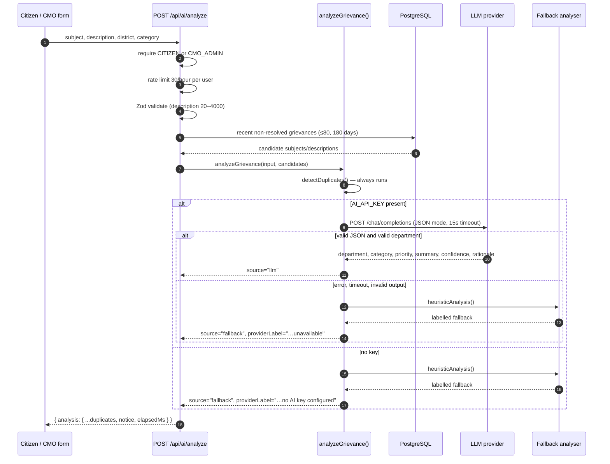

# 05 — AI Integration

## 1. Objective

The **AI Grievance Assistant** helps a citizen or CMO officer triage a complaint faster. It provides four advisory outputs:

1. A suggested **department**.
2. A suggested **category**.
3. A suggested **priority** (**Low / Medium / High**).
4. A short neutral **summary** suitable for a CMO queue.

It also flags **possible duplicates** among recent non-resolved grievances.

The assistant never makes an official decision. It does not submit, assign, escalate, resolve or reopen anything. The citizen chooses whether to adopt its suggestions, and CMO officers can ignore them. Every suggestion is stored for audit and labelled with its source.

## 2. Supported modes

| Mode | When | What the user sees |
| --- | --- | --- |
| **Real LLM** | `AI_API_KEY` is set and the provider returns valid JSON | Provider label `LLM · <model>`, source `llm` |
| **Labelled fallback — no key** | `AI_API_KEY` is empty | Provider label `Labelled fallback (no AI key configured)`, source `fallback` |
| **Labelled fallback — provider failure** | The request fails, times out, or returns unusable output | Provider label `Labelled fallback (AI service unavailable)`, source `fallback` |

This satisfies the machine-test requirement: the feature uses a real LLM API when configured, and otherwise falls back in a way that is clearly disclosed rather than pretending a keyword system is AI. The fallback is intentionally **not** described as an LLM in the UI, API or documentation.

## 3. Provider configuration

The integration uses the **OpenAI-compatible Chat Completions** protocol. Any compatible provider works.

```env
AI_API_KEY="<secret key>"
AI_BASE_URL="https://api.openai.com/v1"
AI_MODEL="gpt-4o-mini"
AI_TIMEOUT_MS="15000"
```

| Variable | Default | Notes |
| --- | --- | --- |
| `AI_API_KEY` | empty | Presence alone enables the LLM path. Never exposed to the browser. |
| `AI_BASE_URL` | `https://api.openai.com/v1` | Trailing slashes are stripped; `/chat/completions` is appended. |
| `AI_MODEL` | `gpt-4o-mini` | Provider-specific model identifier. |
| `AI_TIMEOUT_MS` | `15000` | Aborts the request with `AbortSignal.timeout`. |

Tested/expected compatible endpoints:

| Provider | `AI_BASE_URL` | Example model |
| --- | --- | --- |
| OpenAI | `https://api.openai.com/v1` | `gpt-4o-mini` |
| Groq | `https://api.groq.com/openai/v1` | `llama-3.3-70b-versatile` |
| Google Gemini (OpenAI compatibility) | `https://generativelanguage.googleapis.com/v1beta/openai` | `gemini-2.0-flash` |
| OpenRouter | `https://openrouter.ai/api/v1` | `meta-llama/llama-3.3-70b-instruct:free` |
| Together AI | `https://api.together.xyz/v1` | provider-specific |
| Ollama (local) | `http://localhost:11434/v1` | `llama3.1` |

For the hosted demo, set `AI_API_KEY`, `AI_BASE_URL` and `AI_MODEL` in Vercel and redeploy. Verify with the AI endpoint or the submit form; the response's `source` must be `"llm"` for a real-LLM demonstration.

## 4. Request flow



### Why duplicate detection is separate

Duplicate detection is deterministic and runs even when the LLM is available. This makes the behaviour testable, cheap, explainable and independent of model variability. The LLM is not asked to guess duplicates.

## 5. System prompt

The model receives a system message and a JSON user message. Key instructions (abridged):

```text
You are the AI Grievance Assistant for a Chief Minister's Grievance Redressal
Portal prototype in Kerala, India. You provide advisory triage only; you never
make official decisions.

Analyse the citizen complaint and return ONLY a JSON object with these keys:
departmentCode (string), category (string), priority ("LOW" | "MEDIUM" | "HIGH"),
summary (string, max 45 words), confidence (number 0-1), rationale (string, max 40 words).

Allowed departments: <11 department codes and descriptions>
Allowed categories: <12 categories>

Priority rules:
- HIGH: immediate risk to life, health or safety; vulnerable people; hazardous
  infrastructure; outbreak; repeated failure with danger.
- MEDIUM: genuine service disruption or public inconvenience without immediate danger.
- LOW: suggestions, information requests or minor inconvenience.

Rules:
- Never invent names, locations or facts absent from the complaint.
- Do not repeat sensitive personal data in the summary.
- If the complaint is unclear, choose LSGD and set confidence below 0.4.
- The summary must be neutral and factual, suitable for a CMO officer scanning a queue.
- Return valid JSON only. No markdown fences.
```

The user message is JSON with `subject`, `description`, `district` and `citizenSelectedCategory`. Sending JSON avoids prompt-injection ambiguity from free-form field concatenation (though no system can fully eliminate prompt injection).

### Request parameters

```json
{
  "model": "<AI_MODEL>",
  "temperature": 0.2,
  "max_tokens": 400,
  "response_format": { "type": "json_object" },
  "messages": [ { "role": "system", "content": "..." }, { "role": "user", "content": "..." } ]
}
```

If the provider rejects `response_format` with HTTP 400 or 422, the request is retried once without it. The output is still parsed defensively.

## 6. Output validation

| Field | Handling |
| --- | --- |
| `departmentCode` | Uppercased; must match a seeded code or a seeded department name. Unknown → request fails → labelled fallback |
| `category` | Must be one of the 12 categories; otherwise default category for the resolved department |
| `priority` | Must be `LOW`/`MEDIUM`/`HIGH`; otherwise `MEDIUM` |
| `summary` | Trimmed; fewer than 10 characters → request fails → fallback; truncated to 600 characters |
| `confidence` | Number 0–1; otherwise `0.7` |
| `rationale` | Trimmed and truncated to 500 characters; default text if missing |

JSON is extracted defensively from possible markdown fences or surrounding prose. Invalid JSON is treated as a provider failure.

## 7. Deterministic fallback

Implemented in `heuristicAnalysis()` in `src/lib/ai.ts`.

### 7.1 Department selection

- A keyword table maps English terms to each of the 11 departments.
- The combined subject + description is lowercased.
- Each keyword is matched with a word-boundary regex (or substring for multi-word phrases).
- The department with the most keyword hits wins.
- Ties keep the earlier department in the table order.
- No hits → `LSGD` (Local Self Government) with confidence `0.32`, described as needing human triage.

Examples:

| Text signals | Department |
| --- | --- |
| water, pipeline, tank, contaminated, borewell | KWA |
| electricity, transformer, KSEB, meter, electrocution | KSEB |
| pothole, road, bridge, footpath, streetlight | PWD |
| garbage, waste, drain, mosquito, panchayat | LSGD |
| pension, disability, anganwadi, widow | SWD |

### 7.2 Category selection

The department's default category mapping is used (for example KWA → Water Supply). If no department matched, the fallback keeps the citizen's selected category when it is valid, otherwise `Other`.

### 7.3 Priority

- **HIGH** when two or more high-priority signals match, or one high signal plus a severe term such as collapse, electrocution, death, fire, outbreak, flood, child or hospital.
- **LOW** when low-priority signals match and no high signal does.
- **MEDIUM** otherwise.

High signals include: urgent, emergency, immediately, danger, dangerous, collapse, accident, death, fire, flood, outbreak, contaminated, hospital, critical, life, children, school bus, sinkhole, caved in.

Low signals include: suggestion, request, minor, convenience, when possible, information, query, feedback, improvement.

### 7.4 Summary, confidence and rationale

- Summary: `<category> grievance from <district> regarding “<subject>”: <first 170 characters of description>`, truncated to 280 characters.
- Confidence: `0.32` with no department match; otherwise `min(0.55 + hits × 0.07, 0.86)`.
- Rationale: number of matched signals, up to four matched keywords, and the high-priority signals found.

The fallback is transparent but limited: it is English-keyword-driven, so Malayalam or mixed-language complaints may be routed poorly. This is why it is labelled and never treated as an official decision.

## 8. Duplicate detection

Implemented in `detectDuplicates()`.

1. Tokenise the new description: lowercase, strip punctuation (keeping Malayalam code points), drop words shorter than three characters and common stopwords.
2. If fewer than four unique tokens remain, return no duplicates.
3. Compare against candidate grievances (subject + description token sets):
   - `jaccard = |intersection| / |union|`
   - `overlap = |intersection| / min(newTokenCount, candidateTokenCount)`
   - `score = 0.65 × jaccard + 0.35 × overlap`
4. Drop resolved candidates and anything below `0.45`.
5. Sort descending, return at most three with reference, subject, status, creation date and rounded score.

Candidates come from the API route:

- Created in the last 180 days.
- Status not `RESOLVED`.
- Same district when the citizen selected one.
- Newest 80 records.

Duplicates are advisory. The UI shows possible matches; the citizen can still submit. No automatic merge exists.

## 9. What the UI does with the result

On `/citizen/new`:

- The citizen can request analysis after entering at least 20 characters.
- Suggestions appear with source/provider label, confidence, rationale, summary, department and duplicate list.
- The citizen can **Apply suggestions**, which fills the form fields and marks `aiAdopted: true`, or ignore them and submit their own values.
- The selected priority remains editable.
- The submitted grievance stores the AI summary, suggested department/category/priority, confidence, provider, model and duplicate references.
- A non-internal `AI_ANALYSIS` history entry records that an advisory suggestion was made.
- The citizen timeline and CMO detail show the AI record for transparency.

## 10. Safety, privacy and responsible use

| Concern | Mitigation |
| --- | --- |
| AI making decisions | No write path from AI output to status, assignment or resolution; all actions require a human API call |
| Misleading users | `source`, `providerLabel` and `notice` are always returned; fallback is explicitly labelled |
| Hallucinated facts | Prompt forbids inventing details; summary is derived from complaint text; officers review before acting |
| Sensitive data | The prompt instructs the model not to repeat sensitive personal data; only complaint text, district and category are sent, not name/email/mobile |
| Prompt injection | User content is JSON-encoded in a separate message; the system prompt fixes the task and output schema; output is validated against enums |
| Provider outage | Timeout plus fallback; the form never blocks on AI |
| Cost/abuse | 30 analyses per user per hour, 400 max output tokens, 15-second timeout |
| Data retention | AI metadata is stored on the grievance for audit; duplicate candidates are not persisted as raw prompts |
| Secret exposure | API key is read server-side only and never included in client bundles or error messages |

**Provider data handling:** enabling a cloud LLM sends complaint text to that provider. In a real government deployment, this would require a data-processing agreement, regional hosting, retention rules and a privacy impact assessment. For this prototype, only fictional demonstration data should be used.

## 11. Testing and verification

### Automated tests

`tests/ai.test.ts` covers:

- Water complaint routing to KWA and Water Supply.
- Life-safety escalation to HIGH for a KSEB/electrocution complaint.
- LOW classification for suggestions.
- Citizen category fallback and LSGD routing with confidence 0.32.
- Summary length and ellipsis behaviour.
- Duplicate scoring, resolved-case exclusion, top-three limit and short-input guard.

Run:

```bash
npm test
```

### Manual verification

Without a key:

```bash
curl -s -X POST http://localhost:3000/api/ai/analyze \
  -H "Content-Type: application/json" \
  -b cookies.txt \
  -d '{"description":"The water pipeline near our school has been leaking for three days and children are falling sick."}'
```

Expected: `source: "fallback"`, `providerLabel: "Labelled fallback (no AI key configured)"`, department `KWA`, priority `HIGH` (children + hospital-like risk signals), and an advisory notice.

With a key configured, the same request should return `source: "llm"` and a provider-specific label. If it returns the fallback while a key is set, inspect server logs for the provider status and the fallback reason.

### Demo tips

- If the hosted demo has no LLM key, say clearly in the video: *"No LLM key is configured on this deployment, so the assistant is running its labelled deterministic fallback. The same code switches to the LLM when `AI_API_KEY` is set."*
- If a key is configured, show the provider label and confidence, then change one suggested field to demonstrate human control.

## 12. Known limitations and future work

- English keyword fallback; Malayalam and mixed-language text are weak without an LLM.
- No semantic embeddings for duplicate detection; paraphrases with little token overlap may be missed.
- No retrieval over past resolutions, knowledge base or department SLAs.
- No automatic translation, redaction or PII detection.
- No streaming; the form waits for the full JSON response.
- Model quality depends on the chosen provider and is not benchmarked against labelled Kerala grievance data.
- Future work: multilingual embeddings, calibration against officer decisions, human feedback capture on AI acceptance, provider fallback chain, and a formal evaluation set.

## 13. Requirement traceability

| Requirement | Implementation |
| --- | --- |
| Analyse complaint text | `POST /api/ai/analyze`, `analyzeGrievance()` |
| Suggest department | LLM JSON or keyword heuristic, validated against seeded departments |
| Suggest category | LLM JSON or department default mapping, validated against 12 categories |
| Suggest priority Low/Medium/High | LLM rules or high/low signal heuristics |
| Generate CMO summary | LLM summary field or deterministic summary builder |
| Optionally flag duplicates | Deterministic Jaccard/overlap detection, top 3 |
| Suggestions reviewable | Form shows suggestions; citizen adopts explicitly; `aiAdopted` stored |
| AI must not make official decisions | No AI write path; advisory notice; all changes require authenticated human actions |
| Real LLM or labelled fallback | OpenAI-compatible LLM plus explicit fallback labels; no pretence of AI in fallback mode |
