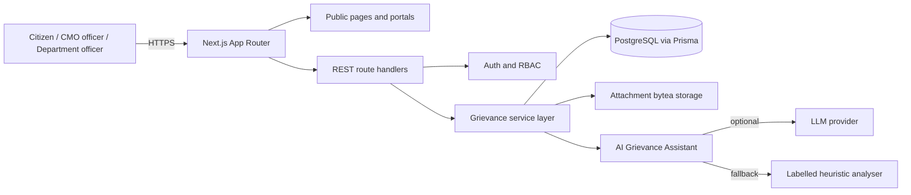

# CM Kerala – Chief Minister's Public Grievance Redressal Portal

A full-stack public grievance redressal portal built for the WhiteMatrix **AI Full Stack Engineer** machine test.

> **Independent demonstration project.** This application is not affiliated with, authorised by, or endorsed by the Government of Kerala or the Chief Minister's Office. All people, departments, grievances, attachments and contact details are fictional demonstration data. Never enter real grievances or official credentials.

---

## 1. Submission fields

Fill these in after deployment (see [DOCUMENTATION/06_Setup_and_Testing.md](DOCUMENTATION/06_Setup_and_Testing.md#10-deployment-vercel--neon)).

| Item | Value |
| --- | --- |
| Hosted application | `https://<your-project>.vercel.app` |
| GitHub repository | `https://github.com/<your-account>/cm-kerala-grievance-portal` |
| Demo video | `https://<your-video-link>` |
| Demo credentials | See the table below — also include these in the submission message |

### Demo accounts

| Role | Email | Password | Landing page |
| --- | --- | --- | --- |
| CMO Administrator | `cmo@kerala.demo` | `Demo@CMO2026` | `/cmo` |
| Department Officer — Health | `health.officer@kerala.demo` | `Demo@Officer2026` | `/officer` |
| Department Officer — Public Works | `pwd.officer@kerala.demo` | `Demo@Officer2026` | `/officer` |
| Citizen | `ananya@example.com` | `Demo@Citizen2026` | `/citizen` |
| Citizen (alternate) | `rahul@example.com` | `Demo@Citizen2026` | `/citizen` |

Officer accounts exist for all 11 seeded departments using the pattern `<department-code>.officer@kerala.demo` (for example `kwa.officer@kerala.demo`), all with the password `Demo@Officer2026`.

Citizen registration is open on `/register`. New accounts are always created with the `CITIZEN` role; CMO and officer accounts are provisioned by the demo seed only.

---

## 2. What is implemented

### Public website
- **Home** — live portal statistics, five-step workflow, feature overview, featured departments.
- **About Us**, **How It Works** (with role responsibilities and workflow), **Departments** (11 departments and contact details), **FAQ**.
- **Track by reference** — public lookup by `KLG-YYYY-XXXXXX` with a visibility-filtered timeline.
- **Contact Us** — enquiries validated on the server and persisted to PostgreSQL. CMO administrators read them at `/cmo/enquiries`.

### Citizen portal
- Register, login and logout with a name, email, mobile number and password.
- Submit a grievance with district, category, subject, description, priority and an optional PNG/JPG/WebP/PDF attachment (up to 4 MB).
- Receive a unique, unambiguous reference number such as `KLG-2026-7K2M9P`.
- Dashboard counts for total, pending, resolved and reopened grievances.
- Grievance detail page with the full public timeline, department, officer, SLA status, resolution report and attachments.
- Star feedback after resolution and a reasoned **Reopen** action when the outcome is not accepted.
- AI Grievance Assistant suggestions that the citizen can adopt or ignore before submitting.

### CMO dashboard
- Command centre with total, pending, resolved and overdue counts, average resolution time, feedback rating, charts by status, priority, district, department, category and an eight-week trend.
- All grievances with filters for district, category, priority, status, department, overdue cases, text search and pagination.
- Review queue for action-taken reports awaiting CMO approval.
- Grievance detail with citizen context, AI triage record, attachments, assignment history and the full audit trail.
- Forward to a department and optionally a specific officer; add internal or citizen-visible remarks; escalate with a reason (raises escalation level and priority).
- Approve an action-taken report (moves to **Resolved**) or reject it with a reason (moves to **Reopened**).
- Contact enquiries inbox.

### Department officer dashboard
- Secure login restricted to the officer's own department queue.
- Department overview with total, active, resolved and awaiting-review counts.
- Grievance detail with attachments, citizen-safe context, internal timeline and remarks.
- Move a case to **In Progress**, add investigation remarks, and submit an action-taken report to the CMO. Officers cannot resolve a case directly.

### AI Grievance Assistant
- Suggest department, category and priority (**Low / Medium / High**) and generate a concise CMO summary from the complaint text.
- Flag possible duplicates against non-resolved grievances from the past 180 days.
- Suggestions are advisory and always require human review; adopting them is an explicit citizen action.
- Uses a real OpenAI-compatible LLM when `AI_API_KEY` is configured. Without a key (or if the provider fails), the UI clearly labels the deterministic fallback and explains that no LLM was used. See [DOCUMENTATION/05_AI_Integration.md](DOCUMENTATION/05_AI_Integration.md).

### Workflow and traceability
Exactly five statuses: **Submitted → Under Review → In Progress → Resolved / Reopened**. Every status change, assignment, remark, escalation, AI suggestion, feedback entry and reopen is written to `GrievanceHistory` with the actor's name, role and timestamp. Internal notes are removed from citizen and public responses at the service layer.

### Engineering
- REST API with a consistent response envelope, server-side Zod validation, RBAC and rate limiting.
- PostgreSQL schema managed with Prisma Migrate (9 tables).
- Password hashing with bcrypt; sessions use a signed, http-only JWT cookie.
- Attachment bytes are stored in PostgreSQL and served through an RBAC-checked route.
- 37 automated unit tests, TypeScript strict typecheck and a verified production build.

---

## 3. Tech stack

| Layer | Choice |
| --- | --- |
| Framework | Next.js 15.5 (App Router), React 19, TypeScript 5.9 |
| Styling | Tailwind CSS v4, custom civic design system, lucide-react icons |
| Backend | Next.js Route Handlers (Node runtime), service layer in `src/lib` |
| Database | PostgreSQL + Prisma ORM 6.19 |
| Auth | bcryptjs + `jose` HS256 JWT in an httpOnly cookie, role-based guards |
| Validation | Zod 3 |
| AI | OpenAI-compatible Chat Completions API with a labelled deterministic fallback |
| Charts | Recharts 3 |
| Tests | Node.js built-in test runner, compiled with TypeScript |

---

## 4. Architecture at a glance



Full diagrams and request flow: [DOCUMENTATION/02_System_Architecture.md](DOCUMENTATION/02_System_Architecture.md). Entity-relationship diagram: [DOCUMENTATION/03_Database_Design.md](DOCUMENTATION/03_Database_Design.md).

---

## 5. Run locally

### Prerequisites
- Node.js 20.9 or newer (Node 22/24 recommended)
- PostgreSQL 14 or newer (Docker is the quickest option)

### Steps

```bash
# 1. Install dependencies
npm install

# 2. Create a PostgreSQL database
docker run --name klg-postgres \
  -e POSTGRES_PASSWORD=postgres \
  -e POSTGRES_DB=cmo_grievance \
  -p 5432:5432 -d postgres:16

# 3. Configure environment
cp .env.example .env
# Edit .env and set DATABASE_URL, DIRECT_URL, AUTH_SECRET, SEED_TOKEN.
# Generate AUTH_SECRET with: openssl rand -base64 48

# 4. Apply the committed migration
npx prisma migrate deploy

# 5. Start the development server
npm run dev
```

Open <http://localhost:3000>.

### Seed the demo data

The seed endpoint is protected by a token and disabled unless explicitly enabled.

```bash
# With ALLOW_DEMO_SEED="true" and SEED_TOKEN="your-token" in .env:
curl -X POST http://localhost:3000/api/admin/seed \
  -H "x-seed-token: your-token"
```

The seed creates 11 departments, 1 CMO administrator, 11 department officers, 4 citizens, 17 fictional grievances with history/feedback/attachments, and 3 contact enquiries. It skips seeding when grievances already exist, so it is safe to call once per database.

Useful checks:

```bash
npm run typecheck   # strict TypeScript
npm test            # 37 unit tests
npm run build       # production build
curl http://localhost:3000/api/health
```

---

## 6. Environment variables

| Variable | Required | Purpose |
| --- | --- | --- |
| `DATABASE_URL` | Yes | PostgreSQL connection string used by the app. On Neon use the pooled URL. |
| `DIRECT_URL` | Yes | Unpooled connection used by Prisma Migrate. Can equal `DATABASE_URL` locally. |
| `AUTH_SECRET` | Yes (production) | HS256 signing secret, at least 32 characters. |
| `AI_API_KEY` | No | Enables real LLM analysis. Without it the UI shows a clearly labelled fallback. |
| `AI_BASE_URL` | No | OpenAI-compatible base URL, default `https://api.openai.com/v1`. |
| `AI_MODEL` | No | Model name, default `gpt-4o-mini`. |
| `AI_TIMEOUT_MS` | No | LLM request timeout in milliseconds, default `15000`. |
| `SEED_TOKEN` | For seeding | Shared secret required by `POST /api/admin/seed` in the `x-seed-token` header. |
| `ALLOW_DEMO_SEED` | For seeding | Must be exactly `true` to enable the seed endpoint. Set to `false` after seeding. |

`.env` is gitignored. **Never commit real credentials, API keys or production URLs containing passwords.**

### Enabling real AI in the hosted demo

Set these in Vercel (or your host), then redeploy:

```env
AI_API_KEY="<your provider key>"
AI_BASE_URL="https://api.openai.com/v1"
AI_MODEL="gpt-4o-mini"
```

Any OpenAI-compatible provider works (OpenAI, Groq, OpenRouter, Gemini's OpenAI compatibility endpoint, Together AI, or a local Ollama). When a key is present the analysis response reports `source: "llm"`; if the provider fails, the response falls back and is labelled as such. No key means the portal still works but the demo should explain that the assistant is running the labelled fallback.

---

## 7. API

All JSON endpoints return `{ "ok": true, "data": ... }` on success and `{ "ok": false, "error": "...", "details": [...] }` on failure. Authentication is an httpOnly `klg_session` cookie. A concise endpoint list:

| Method | Endpoint | Access |
| --- | --- | --- |
| POST | `/api/auth/register` | Public |
| POST | `/api/auth/login` | Public |
| POST | `/api/auth/logout` | Signed in |
| GET | `/api/auth/me` | Public (returns `user: null` when signed out) |
| GET/POST | `/api/grievances` | Signed in / Citizen |
| GET | `/api/grievances/:id` | Scoped by role |
| POST | `/api/grievances/:id/assign` | CMO |
| PATCH | `/api/grievances/:id/status` | CMO / Officer (limited) |
| POST | `/api/grievances/:id/remarks` | CMO / Officer |
| POST | `/api/grievances/:id/escalate` | CMO |
| POST | `/api/grievances/:id/resolution` | Officer |
| POST | `/api/grievances/:id/review` | CMO |
| POST | `/api/grievances/:id/feedback` | Citizen |
| POST | `/api/grievances/:id/reopen` | Citizen |
| GET | `/api/track/:reference` | Public, rate limited |
| GET | `/api/departments` | Public (officer list only when signed in) |
| POST/GET | `/api/contact` | Public / CMO |
| GET | `/api/stats` | CMO |
| POST | `/api/ai/analyze` | Citizen / CMO |
| GET | `/api/attachments/:id` | Scoped by role |
| GET | `/api/health` | Public |
| POST | `/api/admin/seed` | Seed token |

Request bodies, status codes and examples: [DOCUMENTATION/04_API_Documentation.md](DOCUMENTATION/04_API_Documentation.md).

---

## 8. Security and privacy notes

- Role checks exist in both page guards and every mutating API route. Officers are restricted to their own department; citizens to their own grievances and attachments.
- Passwords are hashed with bcrypt (cost 10); login and registration are rate limited. Session cookies are httpOnly, same-site `lax`, and `secure` in production.
- Server-side Zod validation on every write. Attachment type and size are validated server-side, not only in the browser.
- Security headers (CSP, `X-Frame-Options: DENY`, `nosniff`, referrer policy) are set in `next.config.ts`.
- Internal remarks and internal history entries are filtered out of citizen and public tracking responses.
- Demonstration data is fictional. The README and documents clearly state this is an independent demonstration project with no Government of Kerala affiliation.

### Known demonstration limitations
- Rate limits are in-memory and reset on serverless cold starts / differ per instance; production would use Redis.
- No email or SMS delivery. Citizens see updates in the portal and via reference tracking only.
- Attachments are stored as `bytea` in PostgreSQL (suitable for a demo, not for large-scale media). No antivirus scanning.
- The AI summary is advisory and can be wrong; it is never used to decide status, assignment or resolution automatically.
- No formal accessibility audit, localisation or mobile apps. The interface is responsive and keyboard-friendly but not certified.

---

## 9. Documentation

| Document | Contents |
| --- | --- |
| [01 Project Overview](DOCUMENTATION/01_Project_Overview.md) | Problem, scope, users, workflow, deliverables, limitations |
| [02 System Architecture](DOCUMENTATION/02_System_Architecture.md) | Architecture and sequence diagrams, layers, key decisions |
| [03 Database Design](DOCUMENTATION/03_Database_Design.md) | ER diagram, tables, relationships, indexes, enums |
| [04 API Documentation](DOCUMENTATION/04_API_Documentation.md) | Envelope, auth, all endpoints, examples, error codes |
| [05 AI Integration](DOCUMENTATION/05_AI_Integration.md) | Prompting, providers, fallback, duplicates, safety, evaluation |
| [06 Setup and Testing](DOCUMENTATION/06_Setup_and_Testing.md) | Local setup, env, testing matrix, deployment, troubleshooting |
| [07 User Guide](DOCUMENTATION/07_User_Guide.md) | Step-by-step guide for every role |
| [08 Demo Video Script](DOCUMENTATION/08_Demo_Video_Script.md) | Self-recorded 4–5 minute demo script and final checklist |
| [Diagrams](DOCUMENTATION/diagrams/) | Standalone Mermaid source for the architecture and ER diagrams |

---

## 10. Deployment (Vercel + Neon)

1. Push this repository to GitHub (see the exact commands in the setup document).
2. Create a Neon PostgreSQL project and copy both the **pooled** and **unpooled** connection strings.
3. Import the repository into Vercel. The `vercel-build` script runs `prisma generate && prisma migrate deploy && next build`.
4. Add `DATABASE_URL` (pooled), `DIRECT_URL` (unpooled), `AUTH_SECRET`, `SEED_TOKEN`, `ALLOW_DEMO_SEED=true`, and optionally `AI_API_KEY`, `AI_BASE_URL`, `AI_MODEL`.
5. Deploy, then seed once:
   ```bash
   curl -X POST https://<your-project>.vercel.app/api/admin/seed \
     -H "x-seed-token: <SEED_TOKEN>"
   ```
6. Verify `/api/health` returns `database: true` and sign in with each demo role.
7. After seeding, set `ALLOW_DEMO_SEED=false` and redeploy (the endpoint is then permanently disabled).
8. Replace the placeholders in section 1 with the live URL, repository URL and video URL.

Detailed deployment and troubleshooting steps: [DOCUMENTATION/06_Setup_and_Testing.md](DOCUMENTATION/06_Setup_and_Testing.md#10-deployment-vercel--neon).

---

## 11. Suggested submission message

```text
WhiteMatrix AI Full Stack Engineer machine test — CM Kerala Grievance Portal

Hosted application: https://<your-project>.vercel.app
GitHub repository: https://github.com/<your-account>/cm-kerala-grievance-portal
Demo video: https://<your-video-link>

Demo credentials:
- CMO Administrator: cmo@kerala.demo / Demo@CMO2026
- Department Officer (Health): health.officer@kerala.demo / Demo@Officer2026
- Department Officer (Public Works): pwd.officer@kerala.demo / Demo@Officer2026
- Citizen: ananya@example.com / Demo@Citizen2026

The application is an independent demonstration built with fictional data. It is not
affiliated with, authorised by, or endorsed by the Government of Kerala or the
Chief Minister's Office.

AI Grievance Assistant: the hosted demo is configured with an OpenAI-compatible
LLM when AI_API_KEY is set; otherwise the UI explicitly labels the deterministic
fallback and explains that no LLM was used. AI suggestions are advisory and never
make official decisions.
```

---

## 12. Repository map

```text
cm-kerala-grievance-portal/
├─ prisma/                 # schema and committed SQL migration
├─ public/                 # static assets
├─ src/
│  ├─ app/
│  │  ├─ (site)/           # public website and tracking
│  │  ├─ (auth)/           # login and registration
│  │  ├─ citizen/          # citizen portal
│  │  ├─ cmo/              # CMO dashboard
│  │  ├─ officer/          # department officer dashboard
│  │  └─ api/              # REST route handlers
│  ├─ components/          # UI, forms and charts
│  └─ lib/                 # auth, validation, service layer, AI, seed
├─ tests/                  # unit tests
├─ DOCUMENTATION/          # required documentation and diagrams
├─ .env.example
├─ next.config.ts
└─ README.md
```

---

**Built for evaluation on 12 November 2026.** All data is fictional. Do not enter real grievances or official credentials.
